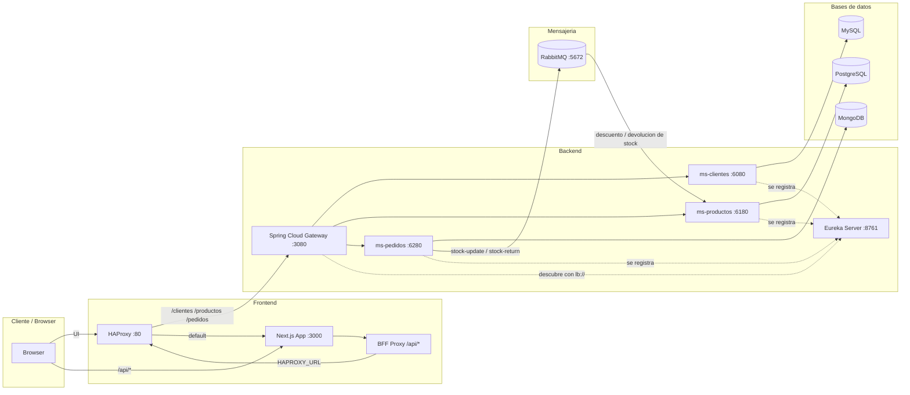

# 🏗️ Sistema de Gestión de Pedidos — Microservicios

Plataforma distribuida de gestión de **clientes, obras, productos y pedidos** para el rubro de la construcción, construida con una arquitectura de microservicios **polyglota** sobre Java/Spring Boot y un frontend moderno con Next.js.

Cada microservicio es independiente, posee su **propia base de datos**, se comunica de forma **asíncrona vía RabbitMQ** y **síncrona vía Feign**, se descubre dinámicamente con **Eureka** y queda detrás de un **API Gateway** único que valida tokens **JWT**. El monitoreo se resuelve con **Prometheus + Grafana**.


---

## 📐 Arquitectura



**Flujo de una petición:**

1. El **browser** entra por **HAProxy** (puerto 80). Las rutas de UI van a **Next.js**; las rutas `/api/*` van al **gateway**.
2. Las páginas de Next.js llaman al **BFF proxy** (`app/api/[...path]/route.ts`), que traduce recursos (`obras`, `productos`, `pedidos`) a los prefijos internos de cada microservicio y reenvía el **JWT** en `Authorization`.
3. El **Spring Cloud Gateway** valida el token, inyecta los headers `X-User-*` y resuelve la instancia real vía **Eureka** (`lb://ms-*`).
4. Cada microservicio opera sobre **su propia base de datos**.
5. La comunicación **asíncrona** entre `ms-pedidos` y `ms-productos` viaja por **RabbitMQ** (actualización y devolución de stock).
6. **Prometheus** scrapea las métricas de Actuator de cada servicio y **Grafana** las visualiza.

---

## 🧩 Microservicios

| Servicio | Puerto host | Base de datos | Responsabilidad |
|---|---|---|---|
| `dan-gateway` | `3080` | — | API Gateway: enrutamiento, validación JWT, propagación de identidad |
| `dan-eureka-srv` | `8761` | — | Service Discovery (registro y resolución de instancias) |
| `ms-clientes` | `6080` | MySQL | Clientes, obras, usuarios y **emisión de JWT** (login) |
| `ms-productos` | `6180` | PostgreSQL | Productos, stock, descuentos y **consumidor de RabbitMQ** |
| `ms-pedidos` | `6280` | MongoDB | Pedidos, estados y **orquestación** (Feign + publicador de RabbitMQ) |

**Bases de datos polyglotas:** MySQL (SQL relacional clásico) para clientes, PostgreSQL para productos y MongoDB (documentos denormalizados) para pedidos.

---

## 🚀 Guía de ejecución rápida

### Requisitos previos

- Docker + Docker Compose
- (Opcional) Java 17, Maven o el wrapper `./mvnw` para correr sin contenedores

### Pasos

```bash
# 1. Crear la red compartida (solo la primera vez)
docker network create backend-net

# 2. (Opcional) Configurar credenciales. Sin .env se usan defaults de desarrollo seguros.
cp .env.example .env

# 3. Levantar el backend completo (Eureka, gateway, 3 microservicios, 3 BD, RabbitMQ, Prometheus, Grafana)
docker compose up -d --build

# 4. Verificar que todo esté healthy
docker compose ps

# 5. Levantar el frontend (Next.js + HAProxy)
docker compose -f docker-compose.frontend.yml up -d --build
```

> ⚠️ **Importante:** cambiá `JWT_SECRET` y las contraseñas de las bases de datos en `.env` antes de cualquier despliegue que no sea desarrollo local.

### Detener el stack

```bash
docker compose down            # detiene servicios (conserva volúmenes de BD)
docker compose down -v         # detiene y borra los volúmenes de BD
```

---

## 🔐 Autenticación (JWT)

1. `POST /api/usuarios/login` con `{ "email": "...", "password": "..." }`.
2. La respuesta incluye el **JWT firmado** (HS256, `jwt.secret` compartido entre `ms-clientes` y `dan-gateway`).
3. Cada request posterior envía `Authorization: Bearer <token>`.
4. El gateway valida el token en cada petición e inyecta `X-User-Email`, `X-User-Nombre`, `X-User-Rol` y `X-User-ClienteId` hacia los microservicios.
5. Las contraseñas se almacenan **haseadas con BCrypt** (nunca en texto plano).

### Usuarios de prueba (seed del `DataInitializer`)

| Rol | Email | Contraseña |
|---|---|---|
| ADMIN | `admin@example.com` | `admin123` |
| GUEST | `guest@example.com` | `guest123` |
| CLIENTE | `juan@constructorasur.com` | `juan123` |
| CLIENTE | `maria@constructorasur.com` | `maria123` |
| CLIENTE | `jose@ghinstalaciones.com` | `jose123` |

---

## 🔌 Endpoints principales

| Recurso | URL |
|---|---|
| Frontend (HAProxy) | `http://localhost/` |
| API Gateway | `http://localhost:3080` |
| Eureka Dashboard | `http://localhost:8761` |
| RabbitMQ Management | `http://localhost:15672` (guest/guest) |
| Prometheus | `http://localhost:9090` |
| Grafana | `http://localhost:3000` (admin/admin) |
| `ms-clientes` | `http://localhost:6080/api/clientes` |
| `ms-productos` | `http://localhost:6180/api/productos` |
| `ms-pedidos` | `http://localhost:6280/api/pedidos` |

**API a través del gateway:** todos los recursos están disponibles bajo el prefijo del microservicio, por ejemplo:

```bash
# Login (sin token)
curl -X POST http://localhost:3080/api/usuarios/login \
  -H "Content-Type: application/json" \
  -d '{"email":"admin@example.com","password":"admin123"}'

# Listar productos (con token)
curl http://localhost:3080/api/productos \
  -H "Authorization: Bearer <TOKEN>"
```

---

## 🗂️ Estructura del proyecto

```
.
├── backend/                     # Microservicios Spring Boot (Maven multi-módulo)
│   ├── dan-eureka-srv/          #   Service Discovery
│   ├── dan-gateway/             #   API Gateway + JWT
│   ├── ms-clientes/             #   Clientes/obras/usuarios (MySQL)
│   ├── ms-productos/            #   Productos/stock (PostgreSQL)
│   └── ms-pedidos/              #   Pedidos (MongoDB + Feign + RabbitMQ)
├── frontend/
│   ├── ui/                      # Aplicación Next.js 16 (App Router, Tailwind 4)
│   └── haproxy/                 # Configuración del reverse proxy
├── grafana/                     # Provisioning y dashboards
├── prometheus.yml               # Targets de scraping de métricas
├── docker-compose.yml           # Stack backend + infraestructura
└── docker-compose.frontend.yml  # Stack frontend (Next.js + HAProxy)
```

---

## ✅ Calidad y testing

- **140+ tests** en el backend (JUnit 5, Mockito, AssertJ y `@WebMvcTest`), incluyendo suites de servicios, controladores, el manejador global de excepciones y el **filtro JWT del gateway**.
- **Tests de repositorio con Testcontainers** (MySQL 8 real en contenedor) en `ms-clientes`, como pide el TP. Requieren Docker; si no está disponible, se **omiten automáticamente** (`@Testcontainers(disabledWithoutDocker = true)`). Se fija `api.version=1.40` en surefire porque el docker-java que usa Testcontainers negocia con API 1.32 y Docker moderno exige ≥ 1.40.
- **Jacoco** con umbral mínimo de cobertura del **80%** en los microservicios.
- Frontend con **TypeScript strict** (`noUnusedLocals`/`noUnusedParameters`), ESLint (neostandard) y React Compiler.
- **Dockerfiles multietapa** con usuario no-root y `HEALTHCHECK`.
- Contenedores con `depends_on` + `service_healthy` para un arranque ordenado.

### Correr los tests

```bash
# Backend (desde la raíz, compila los 5 módulos)
mvn test

# O módulo por módulo con el wrapper
cd backend/ms-clientes && ./mvnw test

# Frontend
cd frontend/ui
npm ci
npm run lint
npm run build
```

---

## 📝 Notas técnicas

- **Base de datos de pedidos:** MongoDB con documentos denormalizados (cliente, obra y producto embebidos). Es el modelo definido por la cátedra para `ms-pedidos`.
- **Comunicación síncrona:** `ms-pedidos` consulta saldo/stock con **Feign clients** hacia `ms-clientes` y `ms-productos`.
- **Comunicación asíncrona:** colas `stock-update-queue` y `stock-return-queue` en **RabbitMQ** para actualizar el stock sin bloquear el pedido.
- **Observabilidad:** Actuator expone solo `health`, `info` y `prometheus` (expuesto de forma controlada).
- **Secretos:** ninguna credencial está hardcodeada en el repositorio; todas las configuraciones usan variables de entorno (ver `.env.example`).

---

## 🛠️ Stack tecnológico

| Capa | Tecnologías |
|---|---|
| Backend | Java 17, Spring Boot 3.2.5, Spring Cloud 2023.0.2, JPA/Hibernate, Spring Data MongoDB, Feign, Spring AMQP |
| Frontend | Next.js 16, React 19, TypeScript 5, Tailwind CSS 4 |
| Bases de datos | MySQL 8, PostgreSQL 17, MongoDB |
| Infraestructura | Docker Compose, HAProxy, RabbitMQ, Eureka, Spring Cloud Gateway |
| Observabilidad | Spring Actuator, Micrometer, Prometheus, Grafana |
| Seguridad | JWT (jjwt 0.12), BCrypt, headers de seguridad en Next.js |
