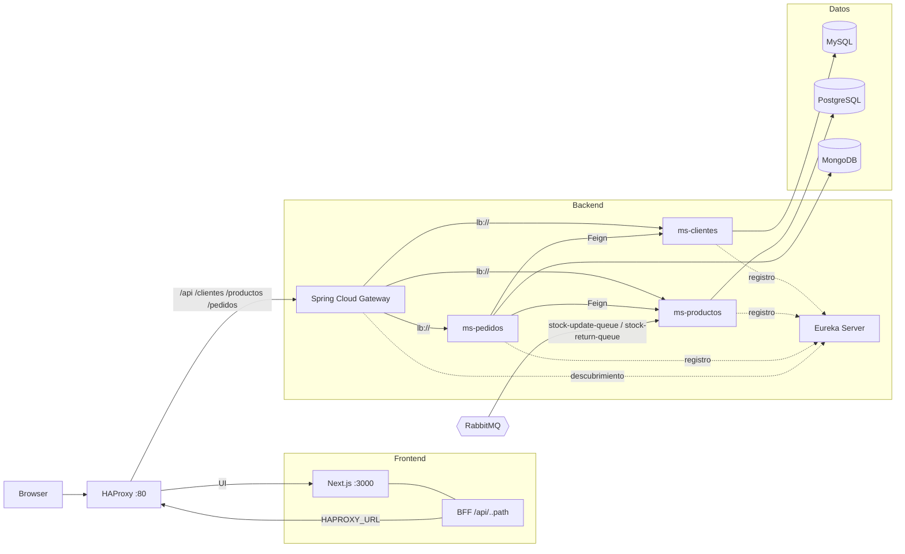
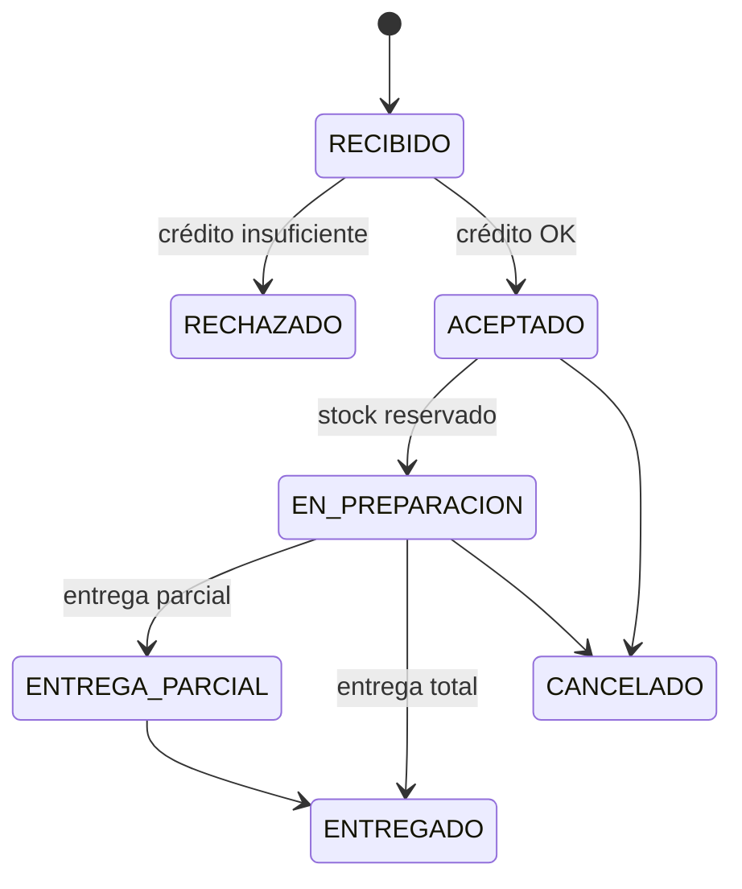
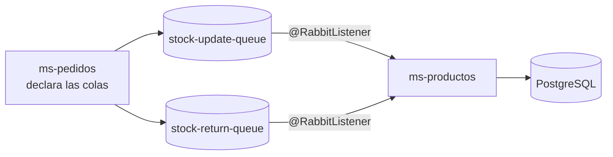
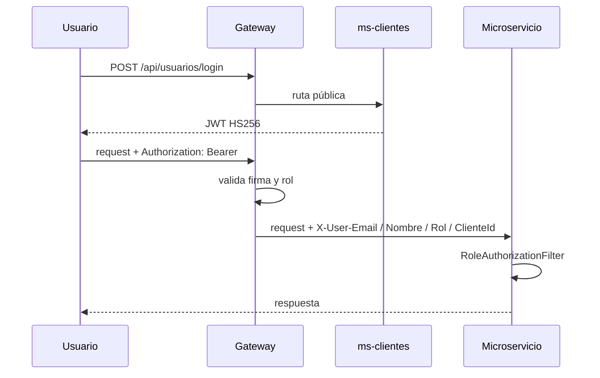
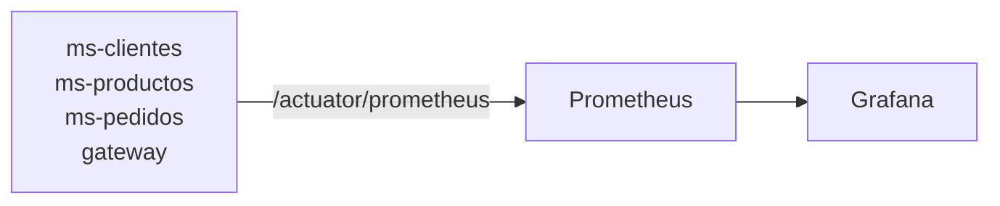

<div align="center">

# VigaDesk

**Plataforma distribuida de gestión de clientes, obras, productos y pedidos para una empresa de materiales de construcción.**

Microservicios · Persistencia políglota · JWT y roles · Mensajería con RabbitMQ · Observabilidad con Prometheus y Grafana


</div>

---

## Tabla de contenidos

1. [Descripción](#descripción)
2. [Arquitectura](#arquitectura)
3. [Módulos y puertos](#módulos-y-puertos)
4. [Funcionalidades por microservicio](#funcionalidades-por-microservicio)
5. [Comunicación y persistencia](#comunicación-y-persistencia)
6. [Seguridad](#seguridad)
7. [Frontend e infraestructura](#frontend-e-infraestructura)
8. [Instalación y ejecución](#instalación-y-ejecución)
9. [Testing y calidad](#testing-y-calidad)
10. [Estructura del repositorio](#estructura-del-repositorio)
11. [Stack tecnológico](#stack-tecnológico)

---

## Descripción

VigaDesk gestiona el ciclo comercial de un corralón de materiales: clientes con su cuenta corriente, obras asociadas, catálogo de productos con stock y pedidos con entregas parciales.

Es un proyecto académico de la cátedra **DAN** de Ingeniería en Sistemas de Información. Su objetivo es aplicar, en un sistema integrado:

- Arquitectura de microservicios.
- Bases de datos poliglotas.
- Comunicación síncrona y asíncrona.
- Seguridad con JWT y control de roles.
- Contenerización con Docker.
- Testing automatizado.
- Observabilidad.

---

## Arquitectura



### Rol de cada componente

| Componente | Rol |
|---|---|
| **HAProxy** | Único punto de entrada. Envía `/api/`, `/clientes/`, `/productos/` y `/pedidos/` al Gateway y el resto al frontend. |
| **Next.js + BFF** | La UI. El BFF (`app/api/[...path]/route.ts`) recibe las llamadas del navegador en `/api/*`, traduce el recurso (`obras`, `productos`, `pedidos`…) al prefijo del microservicio y reenvía el `Authorization`. Evita CORS porque el navegador solo habla con su propio origen. |
| **Spring Cloud Gateway** | Valida el JWT, aplica autorización por rol, inyecta los headers `X-User-*` y resuelve el destino con `lb://` sobre Eureka. |
| **Eureka** | Registro de servicios. Los nombres `ms-clientes`, `ms-productos` y `ms-pedidos` son el contrato de descubrimiento. |
| **Microservicios** | Cada uno es dueño de su base de datos y no accede a la de otro. |
| **RabbitMQ** | Broker para el descuento y la devolución de stock. |
| **Prometheus / Grafana** | Recolección y visualización de métricas de Actuator. |

**Flujo de una petición:** navegador → HAProxy → Next.js (página) → BFF `/api/*` → HAProxy → Gateway (valida JWT) → microservicio → su base de datos.

---

## Módulos y puertos

Todos los servicios Spring escuchan en el **puerto interno 8080** (Eureka en 8761). En `docker-compose.yml` los puertos se publican **solo en `127.0.0.1`**. El único puerto abierto a toda la máquina es el `80` de HAProxy.

| Módulo | Puerto interno | Puerto en el host | Responsabilidad | Base de datos |
|---|---:|---:|---|---|
| `dan-eureka-srv` | 8761 | 8761 | Descubrimiento de servicios | — |
| `dan-gateway` | 8080 | 3080 | API Gateway y validación JWT | — |
| `ms-clientes` | 8080 | 6080 | Clientes, obras, usuarios, pagos y login | MySQL 8.0 |
| `ms-productos` | 8080 | 6180 | Productos, categorías y stock | PostgreSQL 17 |
| `ms-pedidos` | 8080 | 6280 | Pedidos, entregas, auditoría y PDFs | MongoDB 8.3 |
| `frontend-ui` | 3000 | no publicado (se accede por HAProxy) | Interfaz Next.js | — |
| `haproxy` | 80 | 80 | Reverse proxy | — |

---

## Funcionalidades por microservicio

### ms-clientes

- **Clientes:** alta, consulta, modificación y baja lógica; importación masiva (`POST /api/clientes/import`); consulta de saldo y máximo descubierto, que usa `ms-pedidos` vía Feign.
- **Obras:** CRUD, estados `HABILITADA`, `PENDIENTE` y `FINALIZADA`, listado de obras sin asignar o por cliente, y asignación de una obra a un cliente.
- **Pagos:** registro, listado y baja de pagos por cliente (`/api/clientes/{id}/pagos`).
- **Usuarios y autenticación:** CRUD de usuarios, `POST /api/usuarios/login` y emisión del JWT. Las contraseñas se guardan con BCrypt.
- **Migraciones:** Flyway (`V1__init.sql`, `V2__commercial_mvp.sql`).

### ms-productos

- **Productos:** CRUD, búsqueda, importación masiva (`POST /api/productos/import`) y descuentos por producto.
- **Catálogo:** categorías (`GET /api/categorias`) y unidades de medida (`UNIDAD`, `BOLSA`, `KG`, `METRO`, `LITRO`…).
- **Stock:** `stock/check`, `stock/reserve`, `stock/release` y `provision` (reposición).
- **Mensajería:** consume `stock-update-queue` (descuento) y `stock-return-queue` (devolución).
- **Migraciones:** Flyway.

### ms-pedidos

- **Creación de pedidos:** valida cliente y productos, calcula el total con descuentos, compara el consumo con el máximo descubierto del cliente y reserva stock.
- **Idempotencia:** admite una clave de idempotencia para que un reintento no duplique el pedido.
- **Numeración:** secuencia propia (`SecuenciaService`).
- **Entregas parciales:** `POST /api/pedidos/{id}/entregas`, con detalle por ítem.
- **Auditoría:** cada acción relevante se registra y se consulta en `/api/pedidos/{id}/auditoria`.
- **PDFs:** del pedido y de cada entrega, generados con OpenPDF.
- **Búsqueda:** por nombre de cliente, estado y cliente.
- **Compensación:** si falla el guardado, o si se cancela o borra un pedido con stock reservado, el stock se libera.

#### Estados del pedido



Flujo principal: `RECIBIDO → ACEPTADO → EN_PREPARACION → ENTREGA_PARCIAL → ENTREGADO | CANCELADO`. El código define además `RECHAZADO`, que se asigna cuando el pedido supera el máximo descubierto. Si no hay stock suficiente, el pedido queda en `ACEPTADO`.

---

## Comunicación y persistencia

### Comunicación síncrona (OpenFeign)

`ms-pedidos` consulta a los otros servicios por nombre de Eureka:

| Cliente Feign | Destino | Llamadas |
|---|---|---|
| `ClienteFeignClient` | `ms-clientes` | `GET /api/clientes/{id}/saldo`, `GET /api/clientes/{id}/maximo-descubierto` |
| `ProductoFeignClient` | `ms-productos` | `GET /api/productos/{id}`, `PUT /api/productos/stock/check`, `stock/reserve` y `stock/release` |

Hoy la **reserva y liberación de stock** al crear, cancelar o borrar un pedido se hace con estas llamadas Feign.

### Comunicación asíncrona (RabbitMQ)



- `ms-pedidos` declara las colas durables `stock-update-queue` y `stock-return-queue` (`RabbitMQConfig`).
- `ms-productos` las consume con `@RabbitListener`. El mensaje es un texto `idProducto;cantidad`.
- Si el mensaje es inválido o el stock no alcanza, se rechaza sin reencolar (`AmqpRejectAndDontRequeueException`).

> **Nota:** en el código actual de `ms-pedidos` no hay un publicador que envíe a esas colas. El consumidor y las colas están implementados. La reserva y liberación pasan por Feign.

### Persistencia políglota

| Base | Servicio | Por qué |
|---|---|---|
| **MySQL 8.0** | `ms-clientes` | Datos relacionales con integridad referencial: clientes, obras, usuarios y pagos. |
| **PostgreSQL 17** | `ms-productos` | Catálogo y stock con operaciones transaccionales sobre cantidades. |
| **MongoDB 8.3** | `ms-pedidos` | El pedido es un documento autocontenido, con cliente, obra, detalle, entregas y auditoría embebidos. |

Las entidades usan **baja lógica** (`habilitado` y `fechaBorrado`).

---

## Seguridad



1. **Login** en `ms-clientes` (`POST /api/usuarios/login`). Las contraseñas se verifican con **BCrypt**.
2. **JWT HS256** firmado con `JWT_SECRET`. Claims: `sub` (email), `nombre`, `rol` y `clienteId`. Expira en 7200 s por defecto (`jwt.expiration`).
3. El **Gateway** (`JwtAuthFilter`) valida la firma en cada request. Solo son públicos el login y `/actuator/health`.
4. Si el token es válido, el Gateway propaga `X-User-Email`, `X-User-Nombre`, `X-User-Rol` y `X-User-ClienteId`.
5. Cada microservicio aplica un `RoleAuthorizationFilter` que lee `X-User-Rol` y responde 401 si falta.

### Roles

| Rol | Permisos |
|---|---|
| `ADMIN` | Todo. |
| `CLIENTE` | Lectura y alta de pedidos (`POST /api/pedidos`). Sin acceso a `/api/usuarios` ni a `/actuator`. |
| `GUEST` | Solo lectura del catálogo (`/api/productos`, `/api/categorias`). |

Para el rol `CLIENTE`, `ms-pedidos` usa `X-User-ClienteId` y limita las consultas a los pedidos del cliente. Los endpoints Feign `saldo` y `maximo-descubierto` de `ms-clientes` están exentos del filtro para no romper la comunicación entre servicios.

### Otras medidas

- Ningún secreto está en el repositorio. Todo se lee de variables de entorno (`.env.example`) y Compose falla si falta una obligatoria (`${VAR:?}`).
- El frontend envía `Content-Security-Policy`, `X-Content-Type-Options`, `X-Frame-Options`, `Referrer-Policy` y `Permissions-Policy` (`frontend/ui/next.config.ts`).
- Contenedores con usuario no-root.
- Puertos publicados solo en `127.0.0.1`.
- Actuator expone únicamente `health`, `info` y `prometheus`.

---

## Frontend e infraestructura

### Frontend

Next.js 16 (App Router), React 19, TypeScript 5, Tailwind CSS 4 y React Compiler.

| Sección | Contenido |
|---|---|
| Login | Autenticación y sesión (`AuthContext`). |
| Dashboard | Resumen según el rol. |
| Clientes | Tabla, alta y edición, detalle y pagos. |
| Obras | CRUD, cambio de estado y asignación de cliente. |
| Productos | CRUD, descuentos, reposición y alerta de stock bajo. |
| Pedidos | Alta, detalle, cambio de estado y entregas. |
| Usuarios | Administración de usuarios. |
| Importar | Carga masiva de clientes y productos. |

### Docker

- **Dockerfiles multietapa** (dependencias → build → runtime) con usuario no-root y `HEALTHCHECK`.
- **`docker-compose.yml`:** RabbitMQ, Eureka, las tres bases, los tres microservicios, Gateway, Prometheus y Grafana.
- **`docker-compose.frontend.yml`:** Next.js y HAProxy.
- **Arranque ordenado:** los microservicios usan `depends_on` con `condition: service_healthy` sobre RabbitMQ y su base de datos.
- **Red:** ambos archivos usan la red externa `backend-net`, que se crea una vez.
- **`docker-compose.prod.yml`:** overlay que no publica puertos de bases, broker, microservicios, Eureka ni observabilidad.

### HAProxy

`frontend/haproxy/haproxy.cfg` enruta por prefijo de path: `/api/`, `/clientes/`, `/productos/` y `/pedidos/` van al Gateway (`ms-gateway:8080`). El resto va a Next.js (`frontend-ui:3000`).

### Observabilidad



Prometheus (`prometheus.yml`) raspa `/actuator/prometheus` de los cuatro servicios. Grafana trae el datasource de Prometheus y el dashboard `grafana/dashboards/spring-boot.json` provisionados.

---

## Instalación y ejecución

### Requisitos previos

- Docker con Docker Compose v2.
- Para correr tests o servicios fuera de Docker: JDK 17 y Maven (o los `./mvnw` de cada módulo). Para el frontend, Node.js 22 (el que usa el `Dockerfile`).

### 1. Clonar

```bash
git clone https://github.com/AgustinMohr/vigadesk.git
cd vigadesk
```

### 2. Configurar `.env`

```bash
cp .env.example .env
```

Reemplazá todos los valores `__SET__` y `__SET_MIN_64_CHARS__`. Variables definidas en `.env.example`:

| Grupo | Variables |
|---|---|
| MySQL | `MYSQL_DATABASE`, `MYSQL_USER`, `MYSQL_PASSWORD`, `MYSQL_ROOT_PASSWORD` |
| PostgreSQL | `POSTGRES_DB`, `POSTGRES_USER`, `POSTGRES_PASSWORD` |
| MongoDB | `MONGO_INITDB_ROOT_USERNAME`, `MONGO_INITDB_ROOT_PASSWORD` |
| RabbitMQ | `RABBITMQ_USERNAME`, `RABBITMQ_PASSWORD` |
| Seguridad | `JWT_SECRET` (mínimo 64 caracteres), `JWT_EXPIRATION_SECONDS` |
| Grafana | `GRAFANA_ADMIN_USER`, `GRAFANA_ADMIN_PASSWORD` |
| Datos del PDF | `CORRALON_NOMBRE`, `CORRALON_CUIT`, `CORRALON_DIRECCION`, `CORRALON_TELEFONO` |
| Frontend | `HAPROXY_URL`, `SSR_FETCH_URL` |

> **Importante:** `MYSQL_PASSWORD`, `MYSQL_ROOT_PASSWORD`, `POSTGRES_PASSWORD`, `MONGO_INITDB_ROOT_PASSWORD`, `RABBITMQ_USERNAME`, `RABBITMQ_PASSWORD`, `JWT_SECRET` y `GRAFANA_ADMIN_PASSWORD` son obligatorias. Sin ellas `docker compose` aborta. No uses los mismos valores fuera de desarrollo local.

### 3. Crear la red

```bash
docker network create backend-net
```

### 4. Backend e infraestructura

```bash
docker compose up -d --build
docker compose ps
```

### 5. Frontend

El frontend requiere que el backend ya esté corriendo.

```bash
docker compose -f docker-compose.frontend.yml up -d --build
```

### URLs de acceso

| Recurso | URL |
|---|---|
| Aplicación (HAProxy) | http://localhost/ |
| API Gateway | http://localhost:3080 |
| Eureka | http://localhost:8761 |
| RabbitMQ Management | http://localhost:15672 |
| Prometheus | http://localhost:9090 |
| Grafana | http://localhost:3000 |
| `ms-clientes` / `ms-productos` / `ms-pedidos` | http://localhost:6080 / :6180 / :6280 |

Las credenciales de RabbitMQ y Grafana son las que definiste en `.env`.

En el primer arranque, `ms-clientes` carga datos de ejemplo de desarrollo mediante `DataInitializer`, incluido un usuario `ADMIN`. Sus credenciales están en ese archivo. Cambialas antes de cualquier uso real.

### Ejemplo de uso de la API

```bash
curl -X POST http://localhost:3080/api/usuarios/login \
  -H "Content-Type: application/json" \
  -d '{"email":"<email>","password":"<password>"}'

curl http://localhost:3080/api/productos \
  -H "Authorization: Bearer <TOKEN>"
```

El archivo `tests-api.http` reúne más peticiones de ejemplo.

### Detener

```bash
docker compose -f docker-compose.frontend.yml down
docker compose down        # conserva los volúmenes
docker compose down -v     # borra también los datos de las bases
```

### Producción

```bash
docker compose --env-file .env -f docker-compose.yml -f docker-compose.prod.yml up -d
docker compose --env-file .env -f docker-compose.frontend.yml up -d
```

---

## Testing y calidad

### Backend

```bash
mvn test                              # los 5 módulos, desde la raíz
mvn test -pl :ms-clientes -am         # un módulo
cd backend/ms-clientes && ./mvnw test # con el wrapper
```

- **Herramientas:** JUnit 5, Mockito, AssertJ y `@WebMvcTest`.
- **Cobertura temática:** servicios, controladores, manejo global de excepciones, `JwtAuthFilter` del Gateway y repositorios.
- **Testcontainers:** los tests de repositorio de `ms-clientes` corren contra un MySQL real. Requieren Docker y, si no está disponible, se omiten (`@Testcontainers(disabledWithoutDocker = true)`). El `pom.xml` fija `api.version=1.40` por compatibilidad con Docker moderno.
- **JaCoCo:** el umbral de **80 % de cobertura de instrucciones** (`COVEREDRATIO`) está configurado como regla `check` en `ms-clientes`, `ms-pedidos` y `ms-productos`. Es un **objetivo exigido por la build**, no un resultado.

### Estado verificado (corrida local)

| Dato | Valor |
|---|---|
| Métodos de test anotados (`@Test` / `@ParameterizedTest`) | 330 |
| Última corrida local (reportes de Surefire) | 330 ejecutados, 0 fallos, 0 errores, 10 omitidos |
| Cobertura de instrucciones (reporte JaCoCo local) | `dan-gateway` 94,4 %, `ms-clientes` 91,2 %, `ms-productos` 86,2 %, `ms-pedidos` 84,5 % |

Son cifras de reportes locales, no de un pipeline de CI. Para regenerarlas ejecutá `mvn verify` y abrí `target/site/jacoco-aggregate/index.html`.

### Frontend

```bash
cd frontend/ui
npm ci
npm run lint
npm run build
```

TypeScript strict, ESLint con `neostandard` y React Compiler.

---

## Estructura del repositorio

```
.
├── backend/
│   ├── dan-eureka-srv/        # Service discovery
│   ├── dan-gateway/           # API Gateway + JWT
│   ├── ms-clientes/           # Clientes, obras, usuarios, pagos (MySQL)
│   ├── ms-productos/          # Productos y stock (PostgreSQL)
│   └── ms-pedidos/            # Pedidos (MongoDB, Feign)
├── frontend/
│   ├── ui/                    # Next.js 16
│   └── haproxy/               # Configuración del reverse proxy
├── grafana/                   # Provisioning y dashboards
├── ops/                       # Scripts de operación (rotación de secretos)
├── openspec/                  # Especificaciones y cambios
├── prometheus.yml
├── docker-compose.yml
├── docker-compose.frontend.yml
├── docker-compose.prod.yml
├── .env.example
├── tests-api.http
└── pom.xml                    # Agregador Maven de los 5 módulos
```

---

## Stack tecnológico

| Capa | Tecnologías |
|---|---|
| Backend | Java 17, Spring Boot 3.2.5, Spring Cloud 2023.0.2 (Gateway, Eureka, OpenFeign), Spring Data JPA, Spring Data MongoDB, Spring AMQP, Flyway, Lombok, jjwt 0.12.6, OpenPDF 1.3.30 |
| Frontend | Next.js 16, React 19, TypeScript 5, Tailwind CSS 4 |
| Datos | MySQL 8.0, PostgreSQL 17, MongoDB 8.3 |
| Mensajería | RabbitMQ 3.13 |
| Infraestructura | Docker, Docker Compose, HAProxy 3.0 |
| Observabilidad | Spring Actuator, Micrometer, Prometheus 3.14, Grafana 11.3 |
| Testing | JUnit 5, Mockito, AssertJ, `@WebMvcTest`, Testcontainers, JaCoCo 0.8.12 |
