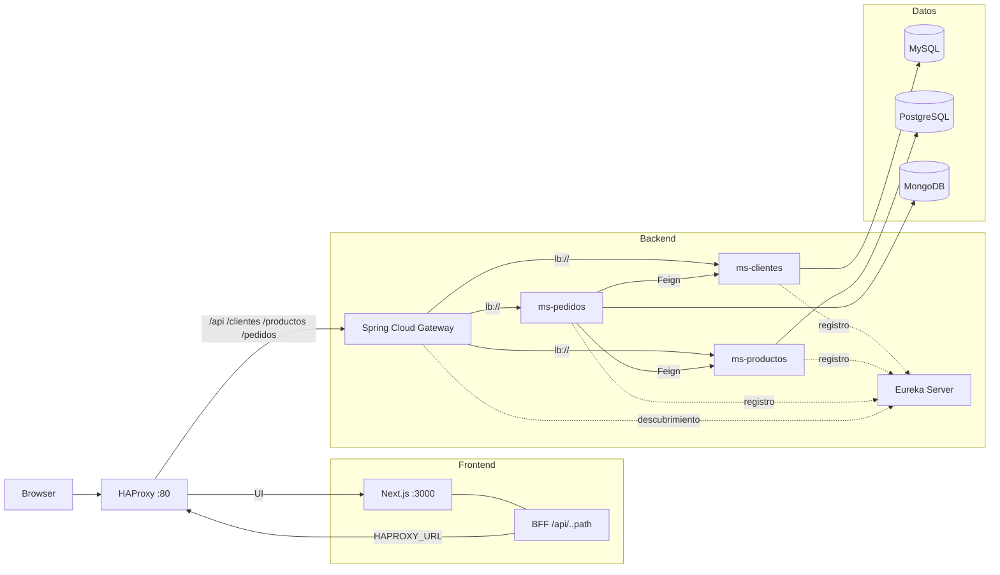
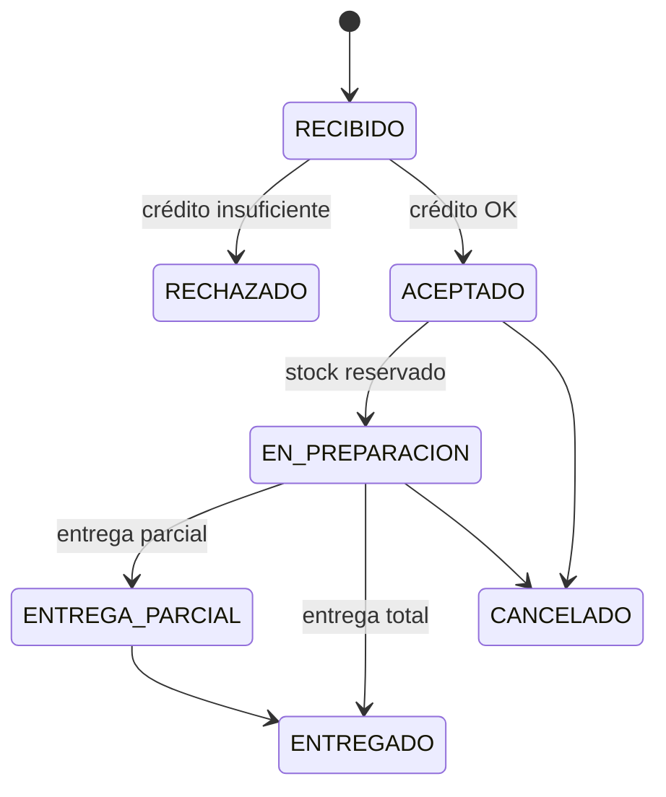
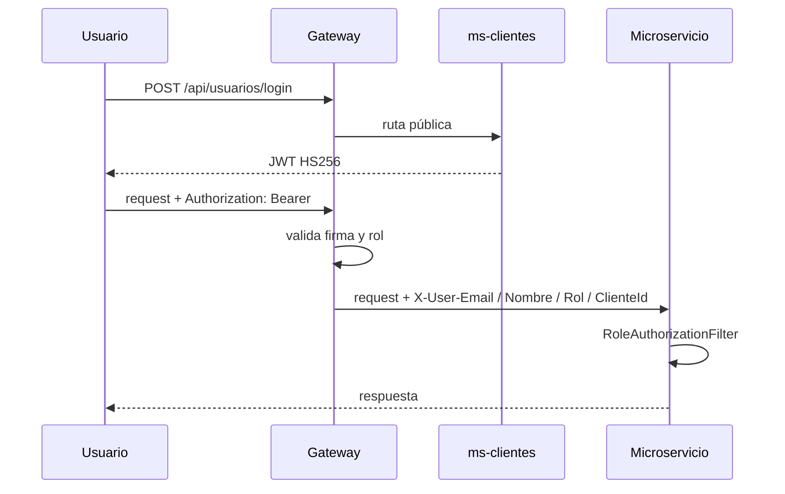
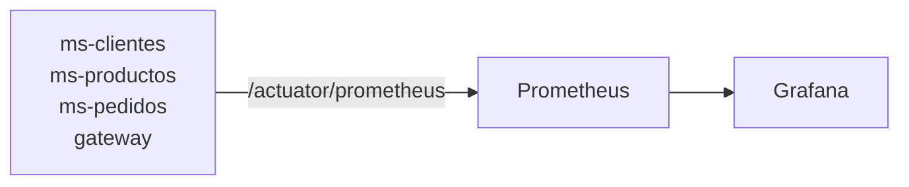

<div align="center">

# VigaDesk

**Plataforma distribuida de gestión de clientes, obras, productos y pedidos para una empresa de materiales de construcción.**

Microservicios · Persistencia políglota · JWT y roles · Observabilidad con Prometheus y Grafana


</div>

---

## Tabla de contenidos

1. [Descripción](#descripción)
2. [Arquitectura](#arquitectura)
3. [Módulos y puertos](#módulos-y-puertos)
4. [Funcionalidades por microservicio](#funcionalidades-por-microservicio)
5. [Comunicación y persistencia](#comunicación-y-persistencia)
6. [Seguridad](#seguridad)
7. [Frontend e infraestructura](#frontend-e-infraestructura)
8. [Instalación y ejecución](#instalación-y-ejecución)
9. [Testing y calidad](#testing-y-calidad)
10. [Estructura del repositorio](#estructura-del-repositorio)
11. [Stack tecnológico](#stack-tecnológico)

---

## Descripción

VigaDesk gestiona el ciclo comercial de un corralón de materiales: clientes con su cuenta corriente, obras asociadas, catálogo de productos con stock y pedidos con entregas parciales.

Es un proyecto académico de la cátedra **DAN** de Ingeniería en Sistemas de Información. Su objetivo es aplicar, en un sistema integrado:

- Arquitectura de microservicios.
- Bases de datos poliglotas.
- Comunicación síncrona y asíncrona.
- Seguridad con JWT y control de roles.
- Contenerización con Docker.
- Testing automatizado.
- Observabilidad.

---

## Arquitectura



### Rol de cada componente

| Componente | Rol |
|---|---|
| **HAProxy** | Único punto de entrada. Envía `/api/`, `/clientes/`, `/productos/` y `/pedidos/` al Gateway y el resto al frontend. |
| **Next.js + BFF** | La UI. El BFF (`app/api/[...path]/route.ts`) recibe las llamadas del navegador en `/api/*`, traduce el recurso (`obras`, `productos`, `pedidos`…) al prefijo del microservicio y reenvía el `Authorization`. Evita CORS porque el navegador solo habla con su propio origen. |
| **Spring Cloud Gateway** | Valida el JWT, aplica autorización por rol, inyecta los headers `X-User-*` y resuelve el destino con `lb://` sobre Eureka. |
| **Eureka** | Registro de servicios. Los nombres `ms-clientes`, `ms-productos` y `ms-pedidos` son el contrato de descubrimiento. |
| **Microservicios** | Cada uno es dueño de su base de datos y no accede a la de otro. |
| **Prometheus / Grafana** | Recolección y visualización de métricas de Actuator. |

**Flujo de una petición:** navegador → HAProxy → Next.js (página) → BFF `/api/*` → HAProxy → Gateway (valida JWT) → microservicio → su base de datos.

---

## Módulos y puertos

Todos los servicios Spring escuchan en el **puerto interno 8080** (Eureka en 8761). En `docker-compose.yml` los puertos se publican **solo en `127.0.0.1`**. El único puerto abierto a toda la máquina es el `80` de HAProxy.

| Módulo | Puerto interno | Puerto en el host | Responsabilidad | Base de datos |
|---|---:|---:|---|---|
| `dan-eureka-srv` | 8761 | 8761 | Descubrimiento de servicios | — |
| `dan-gateway` | 8080 | 3080 | API Gateway y validación JWT | — |
| `ms-clientes` | 8080 | 6080 | Clientes, obras, usuarios, pagos y login | MySQL 8.0 |
| `ms-productos` | 8080 | 6180 | Productos, categorías y stock | PostgreSQL 17 |
| `ms-pedidos` | 8080 | 6280 | Pedidos, entregas, auditoría y PDFs | MongoDB 8.3 |
| `frontend-ui` | 3000 | no publicado (se accede por HAProxy) | Interfaz Next.js | — |
| `haproxy` | 80 | 80 | Reverse proxy | — |

---

## Funcionalidades por microservicio

### ms-clientes

- **Clientes:** alta, consulta, modificación y baja lógica; importación masiva (`POST /api/clientes/import`); consulta de saldo y máximo descubierto, que usa `ms-pedidos` vía Feign.
- **Obras:** CRUD, estados `HABILITADA`, `PENDIENTE` y `FINALIZADA`, listado de obras sin asignar o por cliente, y asignación de una obra a un cliente.
- **Pagos:** registro, listado y baja de pagos por cliente (`/api/clientes/{id}/pagos`).
- **Usuarios y autenticación:** CRUD de usuarios, `POST /api/usuarios/login` y emisión del JWT. Las contraseñas se guardan con BCrypt.
- **Migraciones:** Flyway (`V1__init.sql`, `V2__commercial_mvp.sql`).

### ms-productos

- **Productos:** CRUD, búsqueda, importación masiva (`POST /api/productos/import`) y descuentos por producto.
- **Catálogo:** categorías (`GET /api/categorias`) y unidades de medida (`UNIDAD`, `BOLSA`, `KG`, `METRO`, `LITRO`…).
- **Stock:** `stock/check`, `stock/reserve`, `stock/release` y `provision` (reposición).
- **Migraciones:** Flyway.

### ms-pedidos
- **Creación de pedidos:** `POST /api/pedidos` recibe `{ clienteId?, obraId, observaciones?, lineas: [{ productoId, cantidad }] }`. `clienteId` solo lo usa un `ADMIN`; para `CLIENTE` se toma del token. El servidor fija estado, total, precios, usuario y datos del cliente, e ignora cualquier otro campo. La obra debe existir, estar `HABILITADA` y pertenecer al cliente (`422` si no). Luego valida los productos, calcula el total con descuentos, compara el consumo con el máximo descubierto del cliente (con bloqueo por cliente, así pedidos simultáneos no lo superan) y reserva stock por Feign.
- **Creación de pedidos:** valida cliente y productos, calcula el total con descuentos, compara el consumo con el máximo descubierto del cliente y reserva stock por Feign.
  - Con stock, el pedido queda `EN_PREPARACION`.
  - Sin stock (`409 STOCK_INSUFICIENTE` de `ms-productos`), queda `ACEPTADO` (pendiente de stock) con el evento de auditoría `PEDIDO_PENDIENTE_STOCK`. Un `ADMIN` puede reintentar con `POST /api/pedidos/{id}/reintentar-reserva`.
  - Si `ms-productos` no responde o falla (timeout, 5xx), el pedido no se guarda y la API responde `503`. El reintento con la misma `Idempotency-Key` es seguro.
- **Idempotencia:** el header `Idempotency-Key` (hasta 128 caracteres) es opcional pero recomendado; el formulario del frontend siempre lo envía. La clave se acota por cliente: dos clientes pueden usar el mismo valor.
  - Misma clave y mismo pedido (cliente, obra, observaciones y líneas; el orden de las líneas no importa): devuelve el pedido ya creado, sin repetir la reserva de stock.
  - Misma clave con un pedido distinto: `409`. Hay que usar una clave nueva.
  - Sin el header, cada request crea un pedido nuevo (se genera una clave aleatoria): no hay protección contra reintentos.
- **Numeración:** secuencia propia (`SecuenciaService`).
- **Entregas parciales:** `POST /api/pedidos/{id}/entregas`, con detalle por ítem.
- **Auditoría:** cada acción relevante se registra y se consulta en `/api/pedidos/{id}/auditoria`.
- **PDFs:** del pedido y de cada entrega, generados con OpenPDF.
- **Búsqueda:** por nombre de cliente, estado y cliente.
- **Compensación:** si falla el guardado, o si se cancela o borra un pedido con stock reservado, el stock se libera.

#### Estados del pedido



Flujo principal: `RECIBIDO → ACEPTADO → EN_PREPARACION → ENTREGA_PARCIAL → ENTREGADO | CANCELADO`. El código define además `RECHAZADO`, que se asigna cuando el pedido supera el máximo descubierto. Si no hay stock suficiente, el pedido queda en `ACEPTADO`.

---

## Comunicación y persistencia

### Comunicación síncrona (OpenFeign)

`ms-pedidos` consulta a los otros servicios por nombre de Eureka:

| Cliente Feign | Destino | Llamadas |
|---|---|---|
| `ClienteFeignClient` | `ms-clientes` | `GET /api/clientes/{id}/saldo`, `GET /api/clientes/{id}/maximo-descubierto` |
| `ProductoFeignClient` | `ms-productos` | `GET /api/productos/{id}`, `PUT /api/productos/stock/check`, `stock/reserve` y `stock/release` |

Hoy la **reserva y liberación de stock** al crear, cancelar o borrar un pedido se hace con estas llamadas Feign.

### Mensajería

El sistema **no usa un broker de mensajes**. La reserva y la liberación de stock son llamadas síncronas por Feign, y así el resultado (stock suficiente o no) se conoce al crear el pedido.

> **Decisión R2.12 (2026-11):** se retiró RabbitMQ. Nadie publicaba en las colas `stock-update-queue` y `stock-return-queue`, y sus consumidores descontaban stock sin idempotencia, lo que era un segundo camino para alterarlo. Si una función futura necesita eventos de dominio (por ejemplo notificaciones), se vuelve a incorporar un broker con mensajes JSON, `messageId`, cola de mensajes fallidos y consumidor idempotente. Detalle en `openspec/changes/archive/2026-11-22-retirar-rabbitmq/`.

### Persistencia políglota

| Base | Servicio | Por qué |
|---|---|---|
| **MySQL 8.0** | `ms-clientes` | Datos relacionales con integridad referencial: clientes, obras, usuarios y pagos. |
| **PostgreSQL 17** | `ms-productos` | Catálogo y stock con operaciones transaccionales sobre cantidades. |
| **MongoDB 8.3** | `ms-pedidos` | El pedido es un documento autocontenido, con cliente, obra, detalle, entregas y auditoría embebidos. |

Las entidades usan **baja lógica** (`habilitado` y `fechaBorrado`).

---

## Seguridad



1. **Login** en `ms-clientes` (`POST /api/usuarios/login`). Las contraseñas se verifican con **BCrypt**.
2. **JWT HS256** firmado con `JWT_SECRET`. Claims: `sub` (email), `nombre`, `rol` y `clienteId`. Expira en 7200 s por defecto (`jwt.expiration`).
3. El **Gateway** (`JwtAuthFilter`) valida la firma en cada request. Solo son públicos el login y `/actuator/health`.
4. Si el token es válido, el Gateway propaga `X-User-Email`, `X-User-Nombre`, `X-User-Rol` y `X-User-ClienteId`.
5. Cada microservicio aplica un `RoleAuthorizationFilter` que lee `X-User-Rol` y responde 401 si falta.

### Roles

| Rol | Permisos |
|---|---|
| `ADMIN` | Todo. |
| `CLIENTE` | Lectura y alta de pedidos (`POST /api/pedidos`). Sin acceso a `/api/usuarios` ni a `/actuator`. |
| `GUEST` | Solo lectura del catálogo (`/api/productos`, `/api/categorias`). |

Para el rol `CLIENTE`, `ms-pedidos` usa `X-User-ClienteId` y limita las consultas a los pedidos del cliente. Los endpoints Feign `saldo` y `maximo-descubierto` de `ms-clientes` están exentos del filtro para no romper la comunicación entre servicios.

### Login: contraseñas y límite de intentos

- **Política de contraseñas:** mínimo de 12 caracteres al crear un usuario o cambiar su contraseña (`400` si es más corta). Es la misma longitud que exige la contraseña del administrador inicial.
- **Límite por usuario (`ms-clientes`):** más de 5 intentos fallidos en 60 segundos para un mismo email responden `429` (`TOO_MANY_REQUESTS`) hasta que el primer fallo salga de la ventana, incluso con la contraseña correcta. Se aplica igual exista o no la cuenta, así no revela cuáles existen. Un login correcto reinicia el contador. Se configura con `login.max-failures` y `login.window-seconds`.
- **Límite por IP (Gateway):** más de 30 respuestas `401` en 60 segundos desde una misma IP responden `429` con `Retry-After`, sin llegar a `ms-clientes` (`login.ip-max-failures`, `login.ip-window-seconds`). El navegador llega a través del BFF de Next.js y HAProxy, así que el Gateway ve una IP compartida por todos los usuarios: el umbral es alto a propósito y funciona como freno global, no como límite fino. No se confía en `X-Forwarded-For` salvo que se active `login.trust-forwarded-for=true`, porque un cliente puede falsearlo.
- **Tiempo de respuesta:** si el email no existe se compara la contraseña contra un hash de relleno, para que usuario inexistente y contraseña incorrecta tarden lo mismo.
- Los contadores están **en memoria** (no se agrega Redis solo para esto): se reinician al reiniciar el servicio y, con varias instancias, el límite es por instancia. Un atacante puede bloquear 60 segundos el login de un usuario concreto fallando a propósito; es el costo de proteger las cuentas.

### Búsquedas y paginación

- Los textos de búsqueda (`clienteNombre`, `nombre`, `codigo`) tienen un máximo de 100 caracteres (400 si lo superan) y se toman como literales: en Mongo se escapan con `Pattern.quote` y en SQL se escapan `%` y `_` del `LIKE`. Una expresión regular enviada como texto no se interpreta.
- Los listados (`GET` de clientes, obras, usuarios, productos y pedidos, y las búsquedas de productos y pedidos) aceptan `page` (desde 0) y `size` (por defecto y máximo 100). La respuesta sigue siendo una lista; el total de elementos viaja en la cabecera `X-Total-Count`. El orden es estable: por id, y los pedidos por fecha descendente.
- Los pedidos tienen índices `(cliente._id, estado)` y `fecha`. El frontend trae todas las páginas con `http.getAll`, porque sus tablas filtran y ordenan en memoria.

### Otras medidas

- Ningún secreto está en el repositorio. Todo se lee de variables de entorno (`.env.example`) y Compose falla si falta una obligatoria (`${VAR:?}`).
- El frontend envía `Content-Security-Policy`, `X-Content-Type-Options`, `X-Frame-Options`, `Referrer-Policy` y `Permissions-Policy` (`frontend/ui/next.config.ts`).
- Contenedores con usuario no-root.
- Puertos publicados solo en `127.0.0.1`.
- Actuator expone únicamente `health`, `info` y `prometheus`.

---

## Frontend e infraestructura

### Frontend

Next.js 16 (App Router), React 19, TypeScript 5, Tailwind CSS 4 y React Compiler.

| Sección | Contenido |
|---|---|
| Login | Autenticación y sesión (`AuthContext`). |
| Dashboard | Resumen según el rol. |
| Clientes | Tabla, alta y edición, detalle y pagos. |
| Obras | CRUD, cambio de estado y asignación de cliente. |
| Productos | CRUD, descuentos, reposición y alerta de stock bajo. |
| Pedidos | Alta, detalle, cambio de estado y entregas. |
| Usuarios | Administración de usuarios. |
| Importar | Carga masiva de clientes y productos. |

### Docker

- **Dockerfiles multietapa** (dependencias → build → runtime) con usuario no-root y `HEALTHCHECK`.
- **`docker-compose.yml`:** Eureka, las tres bases, los tres microservicios, Gateway, Prometheus y Grafana.
- **`docker-compose.dev.yml`:** overlay de desarrollo que activa los datos de ejemplo.
- **`docker-compose.frontend.yml`:** Next.js y HAProxy.
- **Arranque ordenado:** los microservicios usan `depends_on` con `condition: service_healthy` sobre su base de datos.
- **Red:** ambos archivos usan la red externa `backend-net`, que se crea una vez.
- **`docker-compose.prod.yml`:** overlay que no publica puertos de bases, broker, microservicios, Eureka ni observabilidad.

### HAProxy

`frontend/haproxy/haproxy.cfg` enruta por prefijo de path: `/api/`, `/clientes/`, `/productos/` y `/pedidos/` van al Gateway (`ms-gateway:8080`). El resto va a Next.js (`frontend-ui:3000`).

### Observabilidad



Actuator escucha en un puerto de gestión interno (`management.server.port`, 8081 por defecto) que no se publica ni se enruta por HAProxy ni por el Gateway. Prometheus (`prometheus.yml`) raspa `/actuator/prometheus` de los cuatro servicios por ese puerto. Grafana trae el datasource de Prometheus y el dashboard `grafana/dashboards/spring-boot.json` provisionados. Con el sistema levantado, `bash ops/smoke-observabilidad.sh` comprueba que los cuatro targets están `UP`, que Actuator no responde por las rutas públicas y que hay métricas HTTP (también corre en el job `End to end` de CI).

---

## Instalación y ejecución

### Requisitos previos

- Docker con Docker Compose v2.
- Para correr tests o servicios fuera de Docker: JDK 17 y Maven (o los `./mvnw` de cada módulo). Para el frontend, Node.js 22 (el que usa el `Dockerfile`).

### 1. Clonar

```bash
git clone https://github.com/AgustinMohr/vigadesk.git
cd vigadesk
```

### 2. Configurar `.env`

```bash
cp .env.example .env
```

Reemplazá todos los valores `__SET__` y `__SET_MIN_64_CHARS__`. Variables definidas en `.env.example`:

| Grupo | Variables |
|---|---|
| MySQL | `MYSQL_DATABASE`, `MYSQL_USER`, `MYSQL_PASSWORD`, `MYSQL_ROOT_PASSWORD` |
| PostgreSQL | `POSTGRES_DB`, `POSTGRES_USER`, `POSTGRES_PASSWORD` |
| MongoDB | `MONGO_INITDB_ROOT_USERNAME`, `MONGO_INITDB_ROOT_PASSWORD` |
| Seguridad | `JWT_SECRET` (mínimo 64 caracteres), `JWT_EXPIRATION_SECONDS` |
| Grafana | `GRAFANA_ADMIN_USER`, `GRAFANA_ADMIN_PASSWORD` |
| Datos del PDF | `CORRALON_NOMBRE`, `CORRALON_CUIT`, `CORRALON_DIRECCION`, `CORRALON_TELEFONO` |
| Frontend | `HAPROXY_URL`, `SSR_FETCH_URL` |

> **Importante:** `MYSQL_PASSWORD`, `MYSQL_ROOT_PASSWORD`, `POSTGRES_PASSWORD`, `MONGO_INITDB_ROOT_PASSWORD`, `JWT_SECRET` y `GRAFANA_ADMIN_PASSWORD` son obligatorias. Sin ellas `docker compose` aborta. No uses los mismos valores fuera de desarrollo local.

### 3. Crear la red

```bash
docker network create backend-net
```

### 4. Backend e infraestructura

El compose base es neutro: no crea usuarios ni datos de ejemplo. Elegí una de dos formas de tener acceso:

```bash
# Desarrollo: carga clientes, obras y usuarios de ejemplo (incluido un ADMIN) si la base está vacía
docker compose -f docker-compose.yml -f docker-compose.dev.yml up -d --build

# Sin datos de ejemplo: el primer administrador sale de BOOTSTRAP_ADMIN_EMAIL y BOOTSTRAP_ADMIN_PASSWORD
# (mínimo 12 caracteres) definidas en .env; sin ellas la base queda sin usuarios y ms-clientes lo avisa en el log
docker compose up -d --build

docker compose ps
```

### 5. Frontend

El frontend requiere que el backend ya esté corriendo.

```bash
docker compose -f docker-compose.frontend.yml up -d --build
```

### URLs de acceso

| Recurso | URL |
|---|---|
| Aplicación (HAProxy) | http://localhost/ |
| API Gateway | http://localhost:3080 |
| Eureka | http://localhost:8761 |
| Prometheus | http://localhost:9090 |
| Grafana | http://localhost:3000 |
| `ms-clientes` / `ms-productos` / `ms-pedidos` | http://localhost:6080 / :6180 / :6280 |

Las credenciales de Grafana son las que definiste en `.env`.

Con el overlay `docker-compose.dev.yml`, `ms-clientes` carga en el primer arranque los datos de ejemplo de `DataInitializer`, incluido un usuario `ADMIN` (credenciales en ese archivo, solo para desarrollo local). Sin el overlay no se crea ningún dato de ejemplo.

### Ejemplo de uso de la API

```bash
curl -X POST http://localhost:3080/api/usuarios/login \
  -H "Content-Type: application/json" \
  -d '{"email":"<email>","password":"<password>"}'

curl http://localhost:3080/api/productos \
  -H "Authorization: Bearer <TOKEN>"
```

El archivo `tests-api.http` reúne más peticiones de ejemplo.

### Detener

```bash
docker compose -f docker-compose.frontend.yml down
docker compose down        # conserva los volúmenes
docker compose down -v     # borra también los datos de las bases
```

### Producción

```bash
docker compose --env-file .env -f docker-compose.yml -f docker-compose.prod.yml up -d
docker compose --env-file .env -f docker-compose.frontend.yml up -d
```

---

## Dependencias y versiones

- El workflow `Dependencias` (`.github/workflows/dependencias.yml`) corre cada lunes, a pedido y en los pull requests que cambian un `pom.xml` o el `package.json`. `npm audit` falla si hay vulnerabilidades altas o críticas en las dependencias de producción del frontend; OWASP Dependency-Check publica el reporte de los módulos Maven como artefacto (informativo; con el secret opcional `NVD_API_KEY` la descarga de la base es mucho más rápida).
- Estado de soporte (verificar las fechas en endoflife.date y en los sitios de cada proyecto antes de decidir):

| Componente | En el proyecto | Estado |
|---|---|---|
| Spring Boot | 3.2.5 | Sin soporte abierto desde fines de 2024; la 3.5 también terminó su soporte abierto en junio de 2026. Línea vigente: 4.x |
| Spring Cloud | 2023.0.2 | Sin soporte; vigente 2025.1 (Oakwood), que acompaña a Boot 4.x |
| MySQL | 8.0 | Fin de vida en abril de 2026; pasar a 8.4 LTS |
| PostgreSQL | 17 | Con soporte |
| MongoDB | 8.3 | Con soporte |
| Grafana | 11.3.0 | Sin soporte; pasar a una versión vigente |
| RabbitMQ | retirado (R2.12) | No aplica |

- Plan de actualización: la rama `chore/actualizar-spring-boot` sube a Spring Boot 3.5.16 y Spring Cloud 2025.0.3 y pasa la suite completa (único cambio necesario: agregar `flyway-database-postgresql` en `ms-productos`, porque Flyway 11 separó el soporte de PostgreSQL). Es el paso previo obligatorio a Boot 4.x, que requiere una migración propia (Spring Framework 7, Jackson 3, anotaciones de test reubicadas).

## Testing y calidad

### Backend

```bash
mvn test                              # los 6 módulos, desde la raíz
mvn test -pl :ms-clientes -am         # un módulo
# El wrapper de un módulo solo sirve si dan-common ya está instalado: mvn install -pl :dan-common
```

- **Reglas de acceso:** viven en `dan-common` (`AccessMatrix`) y las usan el Gateway y los tres microservicios. Se prueban una sola vez en `dan-common`; el Gateway conserva sus pruebas de `JwtAuthFilter` como regresión. Las imágenes de los servicios se construyen con la raíz del repo como contexto (`docker build -f backend/ms-pedidos/Dockerfile .`).
- **Herramientas:** JUnit 5, Mockito, AssertJ y `@WebMvcTest`.
- **Cobertura temática:** servicios, controladores, manejo global de excepciones, `JwtAuthFilter` del Gateway y repositorios.
- **Testcontainers:** los tests de repositorio de `ms-clientes` (MySQL) y `ms-productos` (PostgreSQL) y los de `ms-pedidos` (MongoDB) corren contra bases reales y requieren Docker. En CI no se omite ninguno: `ops/check-no-skipped-tests.sh` hace fallar el job si algún reporte tiene tests omitidos. El `pom.xml` fija `api.version=1.40` por compatibilidad con Docker moderno.
- **JaCoCo:** el umbral de **80 % de cobertura de instrucciones** (`COVEREDRATIO`) está configurado como regla `check` en `ms-clientes`, `ms-pedidos` y `ms-productos`, y lo aplica `mvn verify` (**no** `mvn test`). Es un objetivo exigido por la build, no un resultado.

### Estado verificado (corrida local del 2026-11-23)

| Dato | Valor |
|---|---|
| Tests de backend (reportes de Surefire) | 639 ejecutados, 0 fallos, 0 errores, 0 omitidos (`dan-common` 164, `dan-gateway` 64, `ms-clientes` 193, `ms-productos` 89, `ms-pedidos` 129) |
| Cobertura de instrucciones (reporte JaCoCo local) | `dan-common` 88,9 %, `dan-gateway` 98,0 %, `ms-clientes` 94,5 %, `ms-productos` 91,0 %, `ms-pedidos` 88,2 % |
| Tests de frontend | 108 de Vitest y 2 de Playwright (end to end) |

Son cifras de una corrida local, no un compromiso: la fuente de verdad es el pipeline (`.github/workflows/ci.yml`). Para regenerar las cifras de backend ejecutá `mvn verify` y abrí `target/site/jacoco-aggregate/index.html`.

### Frontend

```bash
cd frontend/ui
npm ci
npm run lint
npm test            # Vitest: unitarias y de componente (jsdom)
npm run build
npm run test:e2e    # Playwright, contra el sistema levantado (ver abajo)
```

TypeScript strict, ESLint con `neostandard` y React Compiler.

Componentes base del frontend (`src/components`): `Modal` (único overlay: `role="dialog"`, `aria-modal`, cierre con Esc, foco inicial y retorno, foco contenido), `Field` (etiqueta asociada al campo con `useId`), `Feedback` (`FeedbackProvider`, `useFeedback`: avisos en una región `aria-live` y confirmaciones en un diálogo; no se usan `alert()` ni `window.confirm()`) y `FetchError`.

Las pruebas unitarias (`frontend/ui/tests/unit`) cubren el cliente HTTP (`http.ts`: 401, 204, errores, paginación), `AuthContext`, `useSort`, `useFetch`, el proxy BFF (whitelist de rutas, cabeceras reenviadas, límite de 5 MB, 502 y 504), los componentes base y la accesibilidad de las pantallas principales con axe-core. La prueba end to end (`frontend/ui/e2e`) inicia sesión, crea un pedido y verifica su estado. Necesita el sistema levantado (`docker compose up -d --build` y `docker compose -f docker-compose.frontend.yml up -d --build`) y un administrador: `E2E_ADMIN_EMAIL` y `E2E_ADMIN_PASSWORD` (los `BOOTSTRAP_ADMIN_*` del `.env`); `E2E_BASE_URL` por defecto es `http://localhost`. Crea sus propios cliente, obra y producto con nombres únicos, así que se puede repetir. En CI corre en el job `End to end`.


---

## Estructura del repositorio

```
.
├── backend/
│   ├── dan-common/            # Módulo compartido: matriz de acceso, normalizador de rutas y filtro de roles
│   ├── dan-eureka-srv/        # Service discovery
│   ├── dan-gateway/           # API Gateway + JWT
│   ├── ms-clientes/           # Clientes, obras, usuarios, pagos (MySQL)
│   ├── ms-productos/          # Productos y stock (PostgreSQL)
│   └── ms-pedidos/            # Pedidos (MongoDB, Feign)
├── frontend/
│   ├── ui/                    # Next.js 16
│   └── haproxy/               # Configuración del reverse proxy
├── grafana/                   # Provisioning y dashboards
├── ops/                       # Scripts de operación (rotación de secretos)
├── openspec/                  # Especificaciones y cambios
├── prometheus.yml
├── docker-compose.yml
├── docker-compose.frontend.yml
├── docker-compose.prod.yml
├── .env.example
├── tests-api.http
└── pom.xml                    # Agregador Maven de los 5 módulos
```

---

## Stack tecnológico

| Capa | Tecnologías |
|---|---|
| Backend | Java 17, Spring Boot 3.2.5, Spring Cloud 2023.0.2 (Gateway, Eureka, OpenFeign), Spring Data JPA, Spring Data MongoDB, Spring AMQP, Flyway, Lombok, jjwt 0.12.6, OpenPDF 1.3.30 |
| Frontend | Next.js 16, React 19, TypeScript 5, Tailwind CSS 4 |
| Datos | MySQL 8.0, PostgreSQL 17, MongoDB 8.3 |
| Infraestructura | Docker, Docker Compose, HAProxy 3.0 |
| Observabilidad | Spring Actuator, Micrometer, Prometheus 3.14, Grafana 11.3 |
| Testing | JUnit 5, Mockito, AssertJ, `@WebMvcTest`, Testcontainers, JaCoCo 0.8.12 |
